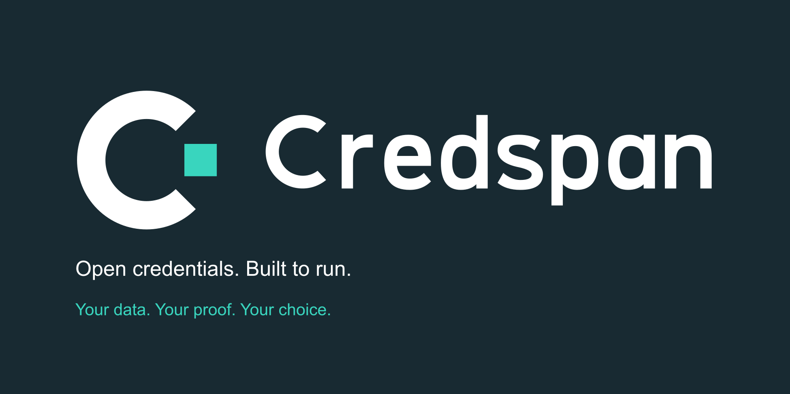

<p align="center"><picture><source media="(prefers-color-scheme: dark)" srcset="docs/assets/brand/logo-dark.svg"></picture></p>

# Credspan

**Your data. Your proof. Your choice.**

People should hold their own credentials and choose what to share. Open standards should let anyone verify those shared proofs without paying a platform for permission.

*Open credentials. Built to run.*



Credspan is an open-source credential platform under development. The current delivery supports local development and a [private, single-owner hosted sandbox](docs/hosted-sandbox.md) using synthetic data only. It is not a general-purpose holder app or production service. The current compatibility slice runs a real NestJS/Express API, Credo and native Askar backed by PostgreSQL. Its **synthetic membership** lane demonstrates OID4VCI 1.0 issuance to a separately implemented wallet and OID4VP 1.0 DCQL presentation verification. It uses an explicitly [modified walt.id Wallet API v2 1.2.1 peer](vendor/waltid/README.md); unmodified-wallet interoperability is not claimed.

The sandbox now exposes [authenticated membership issuance APIs](docs/issuance.md) with bounded attributes, stable credential IDs, server-controlled expiry and durable one-attempt redemption. The fixed profile now includes [authenticated presentation requests/results and signed status/revocation](docs/verification.md) for the local managed membership cohort. A [local React console, management OpenAPI contract and generated TypeScript SDK](docs/developer-experience.md) exercise those same APIs. A [bounded local Compose/Caddy operations slice](docs/operations.md) adds explicit provisioning, restricted runtime roles, encrypted backup/recovery and cohort retirement. An [optional bounded local MCP slice](docs/local-mcp.md) adds diagnostics, nonsecret proposals and explicitly opted-in isolated synthetic tests; production MCP remains later work. The hosted profile adds Cloudflare Access, private Railway ingress and native TLS PostgreSQL on Supabase; its [residual image findings and acceptance limits](SECURITY.md) remain explicit. No private third-party implementation is included. Cryptographic verification is not national-ecosystem conformance or production acceptance.

The [public homepage](https://credspan.m1ngshum.com/) introduces the project; [homepage operations](docs/homepage.md) document its separate static deployment.

## Development

Use Node.js **26.13.1** and pnpm **12.18.0**:

```sh
pnpm install --frozen-lockfile
pnpm check
node vendor/waltid/build-peer.mjs
pnpm test:integration
```

The peer build runs its upstream JVM tests; integration tests use real isolated Docker services, a real external wallet, cross-process replay and restart checks, and negative protocol tests. The [sandbox runbook](docs/sandbox.md) explains manual startup, trust boundaries, provisioning and one-attempt failure semantics. Never put real subject data or production keys in this slice.

See [compatibility evidence and limits](docs/compatibility.md), [the roadmap](ROADMAP.md), [contribution workflow](CONTRIBUTING.md), [agent roles](AGENTS.md), [security policy](SECURITY.md), and [threat model](docs/threat-model.md).

## License

[Apache License 2.0](LICENSE). Branding is included under the same license unless explicitly marked otherwise. Upstream wallet attribution is retained in [vendor/waltid/NOTICE.md](vendor/waltid/NOTICE.md); dependency licenses remain their own.
